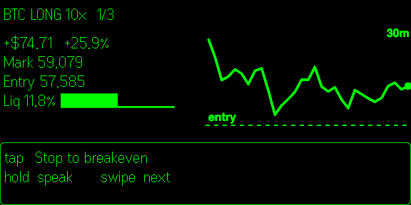
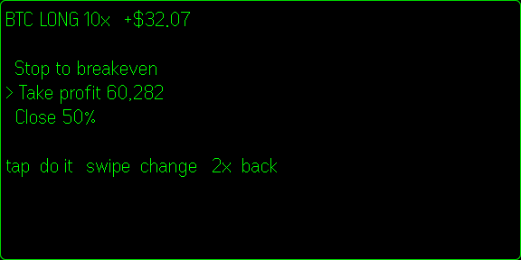
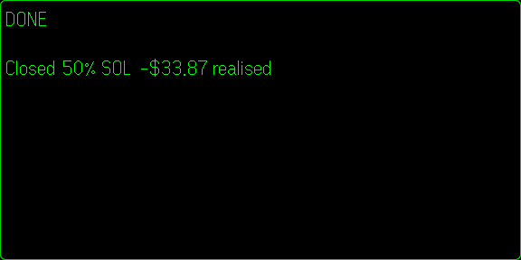
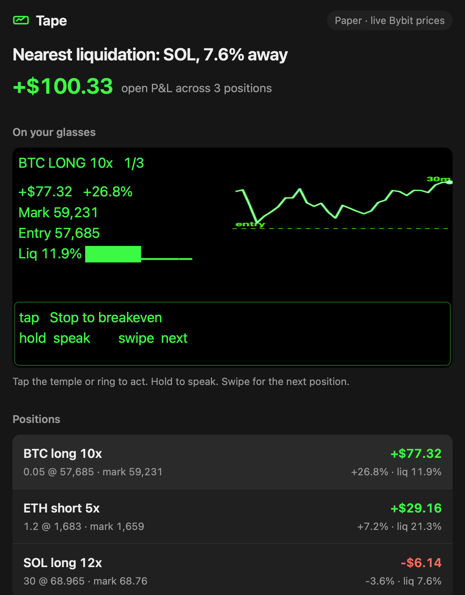

# Tape

Your open futures positions on Even Realities G2 glasses. One position at a time, how far it is from liquidation, and a one-tap way to cut risk without picking up your phone.

Built for Heads Up: Even Realities (Exchanges & Stocks track) on Bybit. It runs on the Bybit testnet, or in a paper mode that uses live Bybit prices and needs no keys at all.



## The problem

During a trading session you look at the same three things over and over: am I up or down, how close am I to liquidation, and do I need to do something. On a phone that means unlocking it, opening the exchange app, finding the position and tapping through an order form, usually while the price is moving.

Tape puts the answer in your line of sight and keeps the common actions to one or two taps.

## What it does

### Reading

- One card per open position: side and leverage, P&L in dollars and %, mark and entry, and a bar showing how much room is left before liquidation.
- A 30-minute price chart with your entry line, drawn from Bybit one-minute candles.
- Swipe (on the glasses or the R1 ring) to move between positions.
- If any position gets within 5% of its liquidation price, the screen switches to a risk warning, whatever position you were looking at.
- Price alerts you set by voice show up the moment they trigger, as long as the app is open.

### Acting

- Tap shows three actions for this position, chosen from its current state: near liquidation leads with Close 50%; in profit with no stop leads with Stop to breakeven; otherwise Take profit +2%. Tap again to do it. Swipe to pick another one first.
- Hold to speak a short command, let go, then tap to confirm:
  - "close half of ETH"
  - "stop to breakeven on bitcoin"
  - "take profit SOL at 160"
  - "alert me if BTC drops below 58k"
- Double tap goes back (or exits from the main card).

Every order is reduce-only. Tape can shrink or protect a position but it can never open one or add to one.

| Actions | Risk warning | Done |
|---|---|---|
|  |  |  |

The phone screen (inside the Even Realities app) mirrors the glasses and lists every position. You can type commands there too, and in paper mode it has buttons to move the market so you can see the risk warning fire.



## How it works

```
G2 glasses / R1 ring                      Tape server (Node, localhost:8787)
  │ tap, swipe, hold, mic PCM                ├─ /api/state   positions + liq distance + actions + alerts
  ▼                                          ├─ /api/action  reduce-only close, stop, take profit, alert
Even Realities app (WebView)  ── fetch ──▶   ├─ /api/voice   PCM → whisper.cpp → command
  Tape web app (Vite + TypeScript)           └─ /api/parse   text → command
  Even Hub SDK: text + image containers             │
                                                    ▼
                                          Bybit v5 API (testnet, signed)  or  paper book on live Bybit prices
```

- Glasses UI (`src/glass/`): pure functions turn app state into G2 containers. Text updates in place without flicker; the page is rebuilt only when the layout changes. The chart is drawn on a canvas and sent as an image.
- Speech to text runs locally with [whisper.cpp](https://github.com/ggml-org/whisper.cpp) (`base.en`). The server keeps the model loaded, so a command is transcribed in about half a second. Nothing is sent to a cloud service.
- Command parsing is rule-based (`server/parse.ts`). If it can't tell which coin or how much, it shows what's missing ("Which coin?") and does nothing. If you set `ANTHROPIC_API_KEY`, Claude rewrites loose phrasing into one of the allowed commands, and that result still goes through the same rule parser and your tap to confirm.
- Exchange (`server/exchange/`): `bybit.ts` signs v5 requests for the testnet; `paper.ts` keeps a simulated book priced off Bybit's public mainnet tickers.
- API keys live only in `server/.env` on your machine. Nothing secret is in the web app.

## Run it

You need Node 22+ and macOS or Linux.

```bash
npm install
npm run server          # terminal 1: Tape server on :8787 (paper mode by default)
npm run dev             # terminal 2: web app on :5173
npm run simulate        # terminal 3: Even Hub simulator pointed at the app
```

Paper mode runs the whole read-and-tap flow without keys or accounts.

### Voice (optional)

```bash
brew install whisper-cpp        # or build whisper.cpp and put whisper-server on PATH
./scripts/get-model.sh          # downloads ggml-base.en.bin (~142 MB) into server/models/
```

Restart `npm run server`. It starts `whisper-server` itself. In the simulator, hold the Long Press button, speak, and let go. You can also type the same commands on the phone screen.

### Bybit testnet (optional)

Create a free account at [testnet.bybit.com](https://testnet.bybit.com), claim test USDT, open a few USDT perpetual positions, and make an API key with Contracts read-write (no withdrawals). Then:

```bash
cat > server/.env <<'ENV'
BYBIT_TESTNET_KEY=...
BYBIT_TESTNET_SECRET=...
ENV
npm run server
```

### On real G2 glasses

Run the server on a machine your phone can reach, build the app with `VITE_TAPE_API=https://your-server npm run build`, add that origin to the `network` whitelist in `app.json`, and either load the dev server with `npx evenhub qr` or install the package from `npm run pack` (`tape.ehpk`).

### Tests

`npm test` (parser, playbook, paper exchange, Bybit signing, server routes, glasses screen limits).

## Safety

- Testnet and paper only. There is no mainnet mode.
- Orders are reduce-only market orders. A stop on the wrong side of the mark price is refused.
- Every action shows what it will do before it happens. Voice commands always need a tap to confirm.
- The ranked actions follow fixed rules you can read in `server/playbook.ts`. They are shortcuts, not trading advice.
- Tape does not store your positions or your voice. Audio is transcribed locally and thrown away.

## What existed before 23 Nov 2026

The Vite config and `index.html` skeleton come from Even Realities' official [`evenhub-templates/asr`](https://github.com/even-realities/evenhub-templates) starter. Everything else in this repo was written during the hackathon (24 to 29 Nov). Libraries and services used: Even Hub SDK, simulator and CLI, whisper.cpp, Bybit v5 API, Vite, TypeScript, Vitest.

## What we'd ask the platforms for

1. Even Hub: a way to show a short alert when the app isn't in the foreground. Liquidation warnings matter most when you're looking at something else.
2. Even Hub: on-device speech to text for short commands, so voice apps don't each need a server.
3. Even Hub: a larger font size for a single line, for one number you want to read from across a desk.
4. Bybit: a "close N% of position" option on `/v5/order/create`, so clients don't have to read the lot size and round quantities themselves.
5. Bybit: an API to claim testnet funds, so demos can be set up from a script.

## License

MIT
